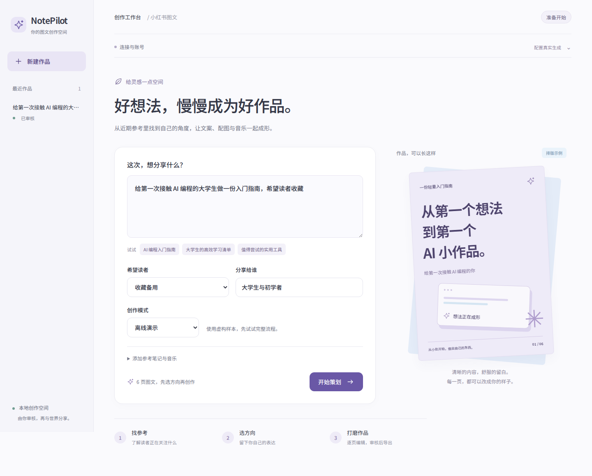

# NotePilot

小红书图文创作 Agent：输入意图 → 调研近期参考 → 选创作方向 → 生成文案与配图方案 → 编辑/选择 BGM → 人工审核 → 导出发布包。

## 创作工作台

浅紫与淡蓝的轻量界面：输入意图、选择方向、大画布预览、逐页编辑，连接设置收进折叠面板。支持手机布局与键盘操作。



[查看编辑工作台](docs/screenshots/editor.png) · [界面设计说明](docs/ui-design.md)

## Mac：拉下来直接启动

```bash
git clone https://github.com/xhy2539/notepilot.git
cd notepilot
bash scripts/start-mac.sh
```

已有仓库：先 `git pull --ff-only` 再运行启动命令。也可双击 `Start-NotePilot.command`。

脚本准备项目专用 Python、依赖、Chromium、Node、中文字体和前端；不会覆盖系统 Python/Node。首次联网下载安装需要一些时间。终端会提示输入百炼 Key（不回显），回车跳过则先运行演示。启动完成自动打开 **http://127.0.0.1:8000**。

你的 M 系列 Mac 自动启动小红书 MCP；在工作台点击“小红书扫码登录”，本人用手机 App 扫码。保持终端打开，Ctrl+C 停止本次启动的服务。

**不能预置的只有你的百炼 Key 与本人扫码登录。** Key、Cookie、浏览器数据都在本地，不在 GitHub。更详细步骤、Intel Mac 路径和排错见 [Mac 使用说明](docs/mac.md)。

## 百炼预设

首次向导创建 `backend/.env`，一份 `DASHSCOPE_API_KEY` 共用：

| 功能 | 默认模型 / 接口 |
|---|---|
| 选题、文案 | qwen-plus，OpenAI 兼容 chat/completions |
| 参考封面分析 | qwen-vl-plus，最多两张真实封面 |
| 原创插画 | qwen-image-2.1-turbo，OpenAI 兼容 images/generations |

默认北京地域公共接口。也可填控制台提供的业务空间专属兼容 URL。模型、Key、接口地址必须同地域，且你账号有模型调用权限。

百炼生图返回 URL，程序会立即从官方 DashScope OSS 域名下载 PNG 并持久化；不跟随跳转、不向图片存储转发 API Key，限制文件大小。泛 OpenAI 接口仍支持 Base64 响应。图片生成单独触发，不会因改文字重画整组图片。

重新配置：`bash scripts/start-mac.sh --configure`；或修改 `backend/.env` 后重启。不要把这个文件、Key 或 Cookie 发到公开 Issue。

## 真实体验流程

1. 运行 Mac 脚本，填写百炼 Key。
2. 在顶部查看配置状态，扫码登录小红书。
3. 选择“真实调研与生成”，输入意图和目标。
4. 选取一个原创方向，生成可编辑的六页图文。
5. 选中需要插画的页面，点击“为这一页生成 AI 插画”。
6. 查看参考来源和音乐，核对事实并保存、审核，下载 PNG 与文案发布包。

没有 Key 时可完整体验离线演示，案例明确标注为虚构结构样本，不是实时热门数据。

## 热门调研与 BGM

复用 [xpzouying/xiaohongshu-mcp](https://github.com/xpzouying/xiaohongshu-mcp) 独立服务。本版只调用搜索、详情、本人登录状态和扫码接口，不调用发布、点赞、收藏或评论。

采集最多 2 个关键词 × 收藏/最新两种排序，一周内样本，深读最多 4 条。文本模型上下文限制为最多 12 条摘要，每条正文 1500 字；减少重复材料和调用开销。未获得的数据标为未知，不虚构互动数/增长速度。

上游目前没有可靠的小红书 BGM 元数据字段：**不能保证全自动取得小红书热门配乐**。可在首页导入实际音乐页候选，或使用已获权限的抖音官方音乐飙升榜（跨平台参考）。发布时需核对小红书曲库及版本，导出包不包含音频。

### 导入格式

首页展开 JSON 框，替换成实际样本：

```json
{
  "samples": [{
    "id": "reference-1",
    "title": "实际参考标题",
    "text": "实际正文",
    "url": "https://www.xiaohongshu.com/explore/实际笔记ID",
    "published_at": "2026-10-13T10:00:00+08:00",
    "saves": 120,
    "likes": 300,
    "questions": ["实际评论问题"]
  }],
  "music": [{
    "id": "music-1",
    "title": "实际曲名",
    "artist": "实际艺人",
    "version": "实际版本",
    "platform": "xiaohongshu",
    "source_url": "https://www.xiaohongshu.com/实际音乐或笔记页面",
    "availability": "unknown"
  }]
}
```

缺失数字填 null 或省略。链接由你核验；程序字段校验不代表已证明内容真实性。

## 其他平台手动运行

Python 3.11+、Node 20+，从仓库根目录：

```bash
python3 -m venv .venv
source .venv/bin/activate
pip install -e './backend[test]'
python -m playwright install chromium
cd frontend
npm ci
npm run build
cd ../backend
cp ../.env.example .env
uvicorn notepilot.app:app --env-file .env --host 127.0.0.1 --port 8000
```

Windows 激活环境用 `.venv\Scripts\Activate.ps1`，复制配置用 `Copy-Item .env.example backend/.env`。开发前端可在 frontend 执行 `npm run dev`，代理后端 8000。只启动后端也要先 npm ci，以便 PNG 使用中文字体。

## 验证与边界

```bash
cd backend
pytest -q
cd ../frontend
npm run build
```

测试包含百炼 URL 生图适配、密钥隔离、URL 校验、登录代理、配置保护、取消、版本冲突、审核失效、无效引用和 PNG 导出。Mac 依赖快照为 backend/requirements-mac.lock，前端为 package-lock.json。

当前验证环境是 Linux，Mac 脚本做了语法与配置/监督进程逻辑检查，**没有在真实 M5 Mac 上安装实测**；也没有你的百炼 Key 和小红书账号。扫码与真实付费请求需要你在本地完成。

这是本地单用户 MVP，不要直接开放公网。平台样本不是权威证据：没有独立事实检索核查工具，发布前需人工核对。后台阶段持久化在 SQLite，任务在进程内；重启后标记 interrupted，重试重跑该阶段，不是 checkpoint 恢复。上游收费请求不保证幂等，响应丢失时重试可能重复计费。

没有自动发布、全站音乐排行榜、音频下载、增长归因或多用户鉴权。Docker 文件保留作可选部署模板，本次未实测构建。

## 设计与复用

React + FastAPI + Pydantic + LangGraph；独立产品设计和工作台，外部复用小红书 MCP。文案、视觉和音乐共同引用同一调研数据对象；程序校验音乐/样本 ID，用户选方向与审核作为应用层持久化门控。

- [架构与后续工作](docs/architecture.md)
- [第三方依赖与许可](THIRD_PARTY_NOTICES.md)
- [规划稿（含未实现功能）](docs/product-design.md)

未复制 RedInk 代码、提示词或资产。redbook 仅作为候选方案调研，本版未集成。

## 云端 UI 演示

之前发布的 chatgpt.site 页面只运行浏览器演示，部分网络会被 Cloudflare 拦截。**Mac 本地运行完全不依赖该站点**，也无需登录 ChatGPT Sites。自行构建演示：frontend 执行 `VITE_CLOUD_DEMO=1 npm run build`，仅用于静态演示；正常 Mac 启动固定使用完整后端。
